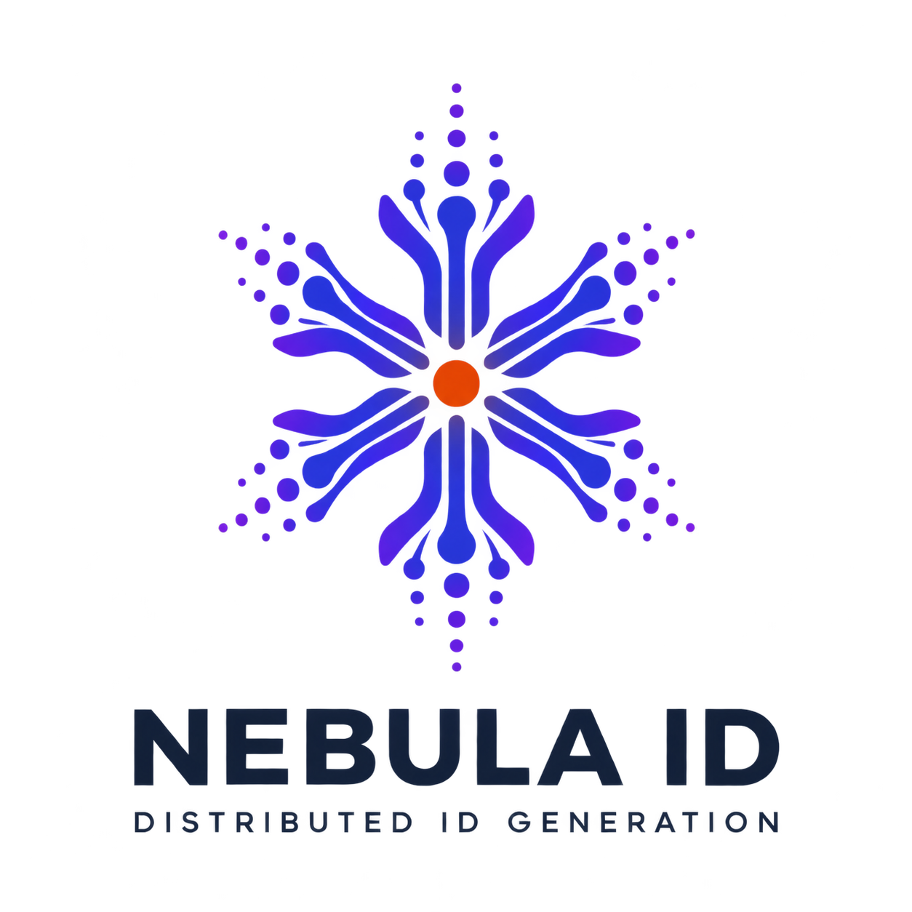

<div align="center">



[](https://www.rust-lang.org/) [](https://github.com/Kirky-X/NebulaId/releases) [](https://github.com/Kirky-X/NebulaId/actions/workflows/ci.yml) [](https://github.com/Kirky-X/NebulaId/actions/workflows/codeql.yml) [](./LICENSE)

English | [中文](README_CN.md)

**Enterprise-grade high-performance distributed ID generation system**

[✨ Features](#-features) • [🚀 Quick Start](#-quick-start) • [📚 Documentation](#-documentation) • [🤝 Contributing](#-contributing)

</div>

---

<div align="center">

### 🎯 One Service, Five ID Algorithms

Double-buffered segments, drift-guarded bit slicing, and the full UUID v4/v7/v8 family — served over HTTP and gRPC alike:

<table style="width:100%; border-collapse: collapse">
<tr>
<td align="center" width="33%">🧮<br><b>Segment</b><br><span style="color:#64748B">Double buffer · dynamic step</span></td>
<td align="center" width="33%">❄️<br><b>Snowflake</b><br><span style="color:#64748B">Bit slicing · clock-drift guard</span></td>
<td align="center" width="33%">🧬<br><b>UUID v8</b><br><span style="color:#64748B">Custom layout · trend-ordered</span></td>
</tr>
<tr>
<td align="center" width="33%">🕒<br><b>UUID v7</b><br><span style="color:#64748B">RFC 9562 time-ordered</span></td>
<td align="center" width="33%">🎲<br><b>UUID v4</b><br><span style="color:#64748B">Random · zero metadata</span></td>
<td align="center" width="33%">🔐<br><b>API Security</b><br><span style="color:#64748B">Key auth · rate limit · audit</span></td>
</tr>
</table>

</div>

---

## 📋 Table of Contents

<details open>
<summary>📑 Table of Contents</summary>

- [✨ Features](#-features)
- [🚀 Quick Start](#-quick-start)
- [📚 Documentation](#-documentation)
- [🤝 Contributing](#-contributing)
- [📄 License](#-license)
- [🙏 Acknowledgments](#-acknowledgments)
- [📞 Contact & Support](#contact--support)
- [⭐ Star History](#-star-history)

</details>

---

## ✨ Features

<table style="width:100%; border-collapse: collapse">
<tr>
<td width="50%" style="vertical-align:top; padding: 12px">🔢 <b>Multi-Algorithm Engine</b><br><span style="color:#64748B">Segment (double buffering + dynamic step), Snowflake (configurable bit layout + clock-drift protection), UUID v8 (RFC 9562 §5.8), routed at runtime by <code>workspace / group / biz_tag</code></span></td>
<td width="50%" style="vertical-align:top; padding: 12px">🌐 <b>Dual-Protocol Access</b><br><span style="color:#64748B">HTTP/HTTPS REST and gRPC/gRPCS share one algorithm router; the sdforge <code>#[forge]</code> macro emits OpenAPI documentation automatically</span></td>
</tr>
<tr>
<td width="50%" style="vertical-align:top; padding: 12px">🧩 <b>Embedded SDK</b><br><span style="color:#64748B">The <code>sdk</code> feature provides <code>NebulaIdKit</code>: trait-kit AsyncKit dependency-graph assembly with missing-dependency errors raised in <code>build()</code>; the <code>embedded</code> example runs with zero DB and zero network</span></td>
<td width="50%" style="vertical-align:top; padding: 12px">🏗️ <b>Distributed Coordination</b><br><span style="color:#64748B">The <code>etcd</code> feature adds worker allocation and coordination, falling back to in-process local locks when endpoints are empty</span></td>
</tr>
<tr>
<td width="50%" style="vertical-align:top; padding: 12px">🔐 <b>garrison Authentication</b><br><span style="color:#64748B">The <code>garrison-auth</code> feature takes over API key verification: Argon2id hashing, constant-time comparison, in-process cache, and rotation grace period</span></td>
<td width="50%" style="vertical-align:top; padding: 12px">🚦 <b>Global Rate Limiting</b><br><span style="color:#64748B">Token bucket genuinely mounted on the HTTP stack, <code>burst ≤ 10 × rps</code> startup validation, <code>x-ratelimit-*</code> response headers, hot updates via the management endpoint</span></td>
</tr>
<tr>
<td width="50%" style="vertical-align:top; padding: 12px">📊 <b>Observability</b><br><span style="color:#64748B">Prometheus <code>/metrics</code> exposes per-algorithm p50/p99/p999 and <code>clock_backwards</code>, plus inklog structured logging and health check endpoints</span></td>
<td width="50%" style="vertical-align:top; padding: 12px">🌍 <b>ICU Internationalization</b><br><span style="color:#64748B">Fluent/ICU stack (fluent-bundle + unic-langid + sys-locale, aligned with the unify-rust-i18n baseline) with <code>Accept-Language</code> negotiation (RFC 7231 §5.3.5); full error and log translations for <code>en</code> and <code>zh-CN</code></span></td>
</tr>
<tr>
<td width="50%" style="vertical-align:top; padding: 12px">🛡️ <b>Transport & Response Security</b><br><span style="color:#64748B">rustls TLS 1.2/1.3 (<code>min_tls_version</code> enforced), security headers, strict CORS, trusted-proxy IP attribution</span></td>
<td width="50%" style="vertical-align:top; padding: 12px">🧾 <b>Audit Logging</b><br><span style="color:#64748B">Full audit trail for ID generation and key operations, with client IPs resolved to real peer connection addresses</span></td>
</tr>
<tr>
<td width="50%" style="vertical-align:top; padding: 12px">⚙️ <b>Config fail-fast</b><br><span style="color:#64748B">All 18 config structs carry <code>deny_unknown_fields</code>; a bad config aborts startup with exit code 1; <code>${VAR}</code> environment expansion built in</span></td>
<td width="50%" style="vertical-align:top; padding: 12px">🧰 <b>Unified Script Entry</b><br><span style="color:#64748B"><code>scripts/run.sh</code> dispatches deploy / lint / redis-test / api-test / install-hooks — the single local development entry point</span></td>
</tr>
</table>

Beyond the core capabilities above, engine declarations other than PostgreSQL (the runtime config enum keeps `sqlite`/`mysql` variants, but the build contains no matching driver, so connecting fails), the `integration-tests` gate for tests that need a real database, hot-reload watching, and Redis caching are also provided via configuration or features; see the [Config Migration Guide](docs/en/CONFIG_MIGRATION_GUIDE.md) for itemized details.

---

## 🚀 Quick Start

<details>
<summary>📄 Code · bash</summary>

```bash
# Clone and build (default features: full server stack + five algorithms + postgresql + garrison-auth + etcd)
git clone https://github.com/Kirky-X/NebulaId.git
cd NebulaId
cargo build --release

# Run the server (reads config/config.toml by default; --config overrides the path)
./target/release/nebula-id
```

</details>

> 💡 `--all-features` **is buildable** (= default + etcd + alerting + sdk + integration-tests + openapi); CI and docs uniformly adopt that switch.

For the full feature table and library-consumer trimming (e.g. UUID v8 only: `nebulaid = { version = "0.3", default-features = false, features = ["uuid-v8"] }`), see the [API Reference · Feature Gates](docs/en/API_REFERENCE.md#-feature-gates); for the minimal embedded-SDK example, see [`examples/embedded.rs`](examples/embedded.rs) (`cargo run --package nebulaid --example embedded --features sdk`). Core concepts (the triple namespace, algorithm selection, the degradation chain) live in the [User Guide · Core Concepts](docs/en/USER_GUIDE.md#core-concepts).

### SDK security posture declaration

Embedded SDK mode has no HTTP stack, so server security capabilities (authentication, rate limiting, audit chain, TLS) are absent. Call `kit.security_posture()` to see what your deployment loses; it reads configuration only and performs no IO. Each check uses one of three states:

| State | Symbol | Meaning |
|-------|--------|---------|
| Enabled | `✓` | Capability is present and active |
| Disabled | `✗` | Capability is absent; the host service must provide it |
| Undeclared | `!` | Configuration exists but no strength profile is declared |

```bash
cargo run --package nebulaid --example sdk_doctor --features sdk
```

The `sdk_doctor` example prints six checks, a summary, and an actionable suggestion. To emit the summary at build time, use `NebulaIdKitBuilder::new(config).posture_announce(true).build().await`; this logs via `tracing::info!` only and never blocks the build.

**Configuration**: the smallest parseable config ships as [`config/config.toml`](config/config.toml); the full options table, `Config::validate()` rules, and per-version migrations live in the [🔧 Config Migration Guide](docs/en/CONFIG_MIGRATION_GUIDE.md).

---

## 📚 Documentation

<details>
<summary>📋 Table</summary>

| Document | Description |
|------|------|
| [📖 User Guide](docs/en/USER_GUIDE.md) | Complete tutorial from installation to advanced usage |
| [📘 API Reference](docs/en/API_REFERENCE.md) | HTTP / gRPC endpoints, headers, error codes, and type definitions |
| [🏗️ Architecture](docs/en/ARCHITECTURE.md) | Module dependencies, external library roles, and algorithm design |
| [🔧 Config Migration Guide](docs/en/CONFIG_MIGRATION_GUIDE.md) | Full config table, validation rules, and version migrations |
| [🚀 Deployment Guide](docs/en/DEPLOYMENT.md) | Docker deployment, environment variables, monitoring, and script subcommands |
| [📈 Performance Guide](docs/en/PERFORMANCE.md) | Benchmark methodology, hot-path design, and optimization tips |
| [🔒 Security](docs/en/SECURITY.md) | Security design, supply chain gates, and vulnerability handling |
| [🧪 Test Scenario Matrix](docs/en/TEST_SCENARIOS.md) | Layered test strategy and scenario matrix (in-depth plan: [Master Test Plan](docs/en/TEST_PLAN.md)) |
| [❓ FAQ](docs/en/FAQ.md) | Frequently asked questions |
| [📋 Changelog](docs/en/CHANGELOG.md) | Change records for every release and the [development roadmap](docs/en/CHANGELOG.md#️-development-roadmap) |
| [🤝 Contributing Guide](docs/en/CONTRIBUTING.md) | How to participate in project development |
| [💻 Examples](examples/) | Embedded SDK and SDK server examples (`sdk` feature) |

</details>

---

## 🤝 Contributing

For the detailed contribution workflow and code standards, see the [🤝 Contributing Guide](docs/en/CONTRIBUTING.md). Run `./scripts/run.sh pre-commit` before committing (or the equivalent lefthook hooks); commit messages follow Conventional Commits. Found an issue? [Create one](https://github.com/Kirky-X/NebulaId/issues/new). Have a great idea? [Start a discussion](https://github.com/Kirky-X/NebulaId/discussions). Want to contribute code? [Fork & PR](https://github.com/Kirky-X/NebulaId/pulls).

**Please do not report security vulnerabilities through public issues**: use the private GitHub [Security Advisories](https://github.com/Kirky-X/NebulaId/security/policy) disclosure channel instead; the full policy is in the [🔒 Security doc](docs/en/SECURITY.md).

---

## 📄 License

This project is licensed under Apache-2.0. See [LICENSE](LICENSE).

---

## 🙏 Acknowledgments

Nebula ID stands on the shoulders of excellent open source projects such as [tokio](https://github.com/tokio-rs/tokio), [axum](https://github.com/tokio-rs/axum), [tonic](https://github.com/hyperium/tonic), [sea-orm](https://github.com/SeaQL/sea-orm), [uuid](https://github.com/uuid-rs/uuid), and [rustls](https://github.com/rustls/rustls), plus the same-author self-developed ecosystem (confers / dbnexus / sdforge / garrison / trait-kit / limiteron / oxcache / inklog). Each dependency's role and version are in the [Architecture doc · External library roles](docs/en/ARCHITECTURE.md#3-external-library-roles).

Thanks to the Rust community and all [contributors](https://github.com/Kirky-X/NebulaId/graphs/contributors).

---

## 📞 Contact & Support

<table style="width:100%; max-width: 600px">
<tr>
<td align="center" width="33%">
<a href="https://github.com/Kirky-X/NebulaId/issues"><b style="color:#991B1B">Issues</b></a><br>
<span style="color:#64748B">Report bugs & issues</span>
</td>
<td align="center" width="33%">
<a href="https://github.com/Kirky-X/NebulaId/discussions"><b style="color:#1E40AF">Discussions</b></a><br>
<span style="color:#64748B">Ask questions & share ideas</span>
</td>
<td align="center" width="33%">
<a href="https://github.com/Kirky-X/NebulaId"><b style="color:#1E293B">GitHub</b></a><br>
<span style="color:#64748B">View source code</span>
</td>
</tr>
</table>

---

## ⭐ Star History

[](https://star-history.com/#Kirky-X/NebulaId&Date)

If you find this project useful, please consider giving it a ⭐️!

**Built by Kirky.X**

---

<sub>© 2026 Kirky.X. All rights reserved.</sub>
