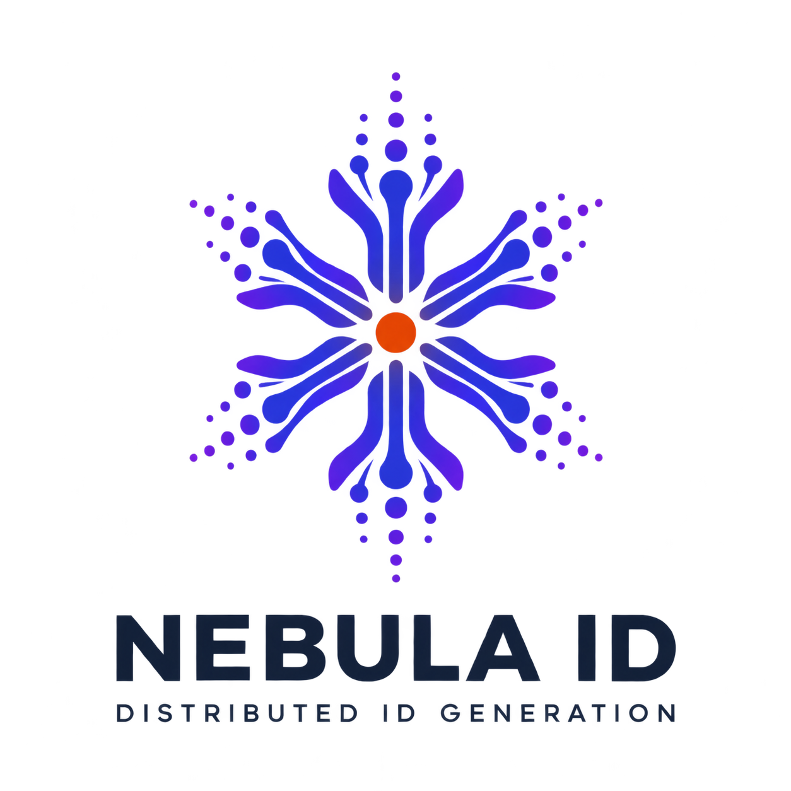

<div align="center">



[](https://www.rust-lang.org/) [](https://github.com/Kirky-X/NebulaId/releases) [](https://github.com/Kirky-X/NebulaId/actions/workflows/ci.yml) [](https://github.com/Kirky-X/NebulaId/actions/workflows/codeql.yml) [](./LICENSE)

[English](README.md) | 中文

**企业级高性能分布式 ID 生成系统**

[✨ 功能特性](#-功能特性) • [🚀 快速开始](#-快速开始) • [📚 文档](#-文档) • [🤝 参与贡献](#-参与贡献)

</div>

---

<div align="center">

### 🎯 一套服务，五种发号算法

号段双缓冲、位切片防回拨、UUID v4/v7/v8 全系布局，HTTP 与 gRPC 同源直达：

<table style="width:100%; border-collapse: collapse">
<tr>
<td align="center" width="33%">🧮<br><b>Segment 号段</b><br><span style="color:#64748B">双缓冲 · 动态步长</span></td>
<td align="center" width="33%">❄️<br><b>Snowflake</b><br><span style="color:#64748B">位切片 · 抗时钟回拨</span></td>
<td align="center" width="33%">🧬<br><b>UUID v8</b><br><span style="color:#64748B">自定义位布局 · 趋势有序</span></td>
</tr>
<tr>
<td align="center" width="33%">🕒<br><b>UUID v7</b><br><span style="color:#64748B">RFC 9562 时间有序</span></td>
<td align="center" width="33%">🎲<br><b>UUID v4</b><br><span style="color:#64748B">随机生成 · 零元数据</span></td>
<td align="center" width="33%">🔐<br><b>API 安全</b><br><span style="color:#64748B">密钥认证 · 限流审计</span></td>
</tr>
</table>

</div>

---

## 📋 目录

<details open>
<summary>📑 目录</summary>

- [✨ 功能特性](#-功能特性)
- [🚀 快速开始](#-快速开始)
- [📚 文档](#-文档)
- [🤝 参与贡献](#-参与贡献)
- [📄 许可证](#-许可证)
- [🙏 致谢](#-致谢)
- [📞 联系与支持](#-联系与支持)
- [⭐ Star 历史](#-star-历史)

</details>

---

## ✨ 功能特性

<table style="width:100%; border-collapse: collapse">
<tr>
<td width="50%" style="vertical-align:top; padding: 12px">🔢 <b>多算法引擎</b><br><span style="color:#64748B">Segment 号段（双缓冲 + 动态步长）、Snowflake（位布局可配 + 时钟回拨防护）、UUID v8（RFC 9562 §5.8），运行时按 <code>workspace / group / biz_tag</code> 路由</span></td>
<td width="50%" style="vertical-align:top; padding: 12px">🌐 <b>双协议接入</b><br><span style="color:#64748B">HTTP/HTTPS REST 与 gRPC/gRPCS 共用同一算法路由，sdforge <code>#[forge]</code> 自动产出 OpenAPI 文档</span></td>
</tr>
<tr>
<td width="50%" style="vertical-align:top; padding: 12px">🧩 <b>嵌入式 SDK</b><br><span style="color:#64748B"><code>sdk</code> feature 提供 <code>NebulaIdKit</code>：trait-kit AsyncKit 依赖图装配，缺失依赖在 <code>build()</code> 期报错；<code>embedded</code> 示例零 DB 零网络运行</span></td>
<td width="50%" style="vertical-align:top; padding: 12px">🏗️ <b>分布式协调</b><br><span style="color:#64748B"><code>etcd</code> feature 提供工作器分配与协调，端点为空时自动退回进程内本地锁</span></td>
</tr>
<tr>
<td width="50%" style="vertical-align:top; padding: 12px">🔐 <b>garrison 认证</b><br><span style="color:#64748B"><code>garrison-auth</code> feature 接管 API key 验证：Argon2id 哈希、常量时间比较、进程内缓存、轮换宽限期</span></td>
<td width="50%" style="vertical-align:top; padding: 12px">🚦 <b>全局限流</b><br><span style="color:#64748B">令牌桶真实挂载 HTTP 栈，<code>burst ≤ 10 × rps</code> 启动校验，<code>x-ratelimit-*</code> 响应头，管理接口热更新</span></td>
</tr>
<tr>
<td width="50%" style="vertical-align:top; padding: 12px">📊 <b>可观测性</b><br><span style="color:#64748B">Prometheus <code>/metrics</code> 逐算法暴露 p50/p99/p999 与 <code>clock_backwards</code>，inklog 结构化日志，健康检查端点</span></td>
<td width="50%" style="vertical-align:top; padding: 12px">🌍 <b>ICU 国际化</b><br><span style="color:#64748B">Fluent/ICU 栈（fluent-bundle + unic-langid + sys-locale，对齐 unify-rust-i18n 基线）+ <code>Accept-Language</code> 协商（RFC 7231 §5.3.5），<code>en</code> 与 <code>zh-CN</code> 全量错误文案与日志</span></td>
</tr>
<tr>
<td width="50%" style="vertical-align:top; padding: 12px">🛡️ <b>传输与响应安全</b><br><span style="color:#64748B">rustls TLS 1.2/1.3（<code>min_tls_version</code> 强制）、安全响应头、严格 CORS、可信代理 IP 归属</span></td>
<td width="50%" style="vertical-align:top; padding: 12px">🧾 <b>审计日志</b><br><span style="color:#64748B">ID 生成与密钥操作全量审计，客户端 IP 解析到真实对端连接地址</span></td>
</tr>
<tr>
<td width="50%" style="vertical-align:top; padding: 12px">⚙️ <b>配置 fail-fast</b><br><span style="color:#64748B">18 个配置结构体全部 <code>deny_unknown_fields</code>，坏配置以退出码 1 终止启动；<code>${VAR}</code> 环境变量展开</span></td>
<td width="50%" style="vertical-align:top; padding: 12px">🧰 <b>统一脚本入口</b><br><span style="color:#64748B"><code>scripts/run.sh</code> 调度 deploy / lint / redis-test / api-test / install-hooks，统一本地开发入口</span></td>
</tr>
</table>

除上述核心能力外，PostgreSQL 之外的引擎声明（运行时配置枚举保留 `sqlite`/`mysql` 变体，但构建不含对应驱动，连接会失败）、需要真实数据库的 `integration-tests` 门控、热重载监听与 Redis 缓存等也以配置或 feature 形式提供；逐项说明见 [配置迁移指南](docs/cn/CONFIG_MIGRATION_GUIDE.md)。

---

## 🚀 快速开始

<details>
<summary>📄 代码 · bash</summary>

```bash
# 克隆仓库并构建（default 特性：server 全栈 + 五种算法 + postgresql + garrison-auth + etcd）
git clone https://github.com/Kirky-X/NebulaId.git
cd NebulaId
cargo build --release

# 运行服务（默认读取 config/config.toml，--config 可指定路径）
./target/release/nebula-id
```

</details>

> 💡 `--all-features` **可构建**（= default + etcd + alerting + sdk + integration-tests + openapi），CI 与文档统一采用该口径。

Feature 全表与库消费剪裁（如只用 UUID v8：`nebulaid = { version = "0.3", default-features = false, features = ["uuid-v8"] }`）见 [API 参考 · Feature Gates](docs/cn/API_REFERENCE.md#-feature-gates)；嵌入式 SDK 最小示例见 [`examples/embedded.rs`](examples/embedded.rs)（`cargo run --package nebulaid --example embedded --features sdk`）。核心概念（三元组命名空间、算法选择、降级链）见 [用户指南 · 核心概念](docs/cn/USER_GUIDE.md#核心概念)。

### SDK 安全姿态声明

嵌入式 SDK 形态无 HTTP 栈，server 侧安全能力（认证、限流、审计链、TLS）不在场。调用 `kit.security_posture()` 即可查看部署失去哪些能力；盘点只读配置，零 IO。每项检查为三态之一：

| 状态 | 符号 | 含义 |
|------|------|------|
| Enabled | `✓` | 能力在场且已启用 |
| Disabled | `✗` | 能力不在场；宿主服务须自行提供 |
| Undeclared | `!` | 配置存在但未声明强度档位 |

```bash
cargo run --package nebulaid --example sdk_doctor --features sdk
```

`sdk_doctor` 示例打印六项检查、摘要与一条可操作建议。若要在 build 期输出摘要，用 `NebulaIdKitBuilder::new(config).posture_announce(true).build().await`；该开关只经 `tracing::info!` 记录日志，绝不阻止 build。

**配置**：最小可解析配置见 [`config/config.toml`](config/config.toml)；全量选项表、`Config::validate()` 校验规则与版本迁移见 [🔧 配置迁移指南](docs/cn/CONFIG_MIGRATION_GUIDE.md)。

---

## 📚 文档

<details>
<summary>📋 表格</summary>

| 文档 | 说明 |
|------|------|
| [📖 用户指南](docs/cn/USER_GUIDE.md) | 从安装到进阶的完整使用教程 |
| [📘 API 参考](docs/cn/API_REFERENCE.md) | HTTP / gRPC 端点、请求头、错误码与类型定义 |
| [🏗️ 架构文档](docs/cn/ARCHITECTURE.md) | 模块依赖、外部库角色与算法优化设计 |
| [🔧 配置迁移指南](docs/cn/CONFIG_MIGRATION_GUIDE.md) | 配置全表、校验规则与版本间迁移操作 |
| [🚀 部署指南](docs/cn/DEPLOYMENT.md) | Docker 部署、环境变量、监控与脚本子命令 |
| [📈 性能指南](docs/cn/PERFORMANCE.md) | 基准口径、热路径设计与优化建议 |
| [🔒 安全文档](docs/cn/SECURITY.md) | 安全设计、供应链门禁与漏洞处理流程 |
| [🧪 测试场景矩阵](docs/cn/TEST_SCENARIOS.md) | 分层测试策略与场景穷举（深度方案：[测试总体方案](docs/cn/TEST_PLAN.md)） |
| [❓ FAQ](docs/cn/FAQ.md) | 常见问题解答 |
| [📋 更新日志](docs/cn/CHANGELOG.md) | 每个版本的变更记录与[开发路线图](docs/cn/CHANGELOG.md#️-开发路线图) |
| [🤝 贡献指南](docs/cn/CONTRIBUTING.md) | 如何参与项目开发 |
| [💻 示例](examples/) | 嵌入式 SDK 与 SDK 服务器示例（`sdk` feature） |

</details>

---

## 🤝 参与贡献

详细的贡献流程与代码规范请参阅 [🤝 贡献指南](docs/cn/CONTRIBUTING.md)。提交前运行 `./scripts/run.sh pre-commit`（或 lefthook 等价钩子）；commit message 遵循 Conventional Commits。发现问题请 [创建 Issue](https://github.com/Kirky-X/NebulaId/issues/new)，有好想法请 [开始讨论](https://github.com/Kirky-X/NebulaId/discussions)，想贡献代码请 [Fork 并提交 PR](https://github.com/Kirky-X/NebulaId/pulls)。

**安全漏洞请勿通过公开 issue 报告**：请使用 GitHub [Security Advisories](https://github.com/Kirky-X/NebulaId/security/policy) 私密披露通道提交报告，完整政策见 [🔒 安全文档](docs/cn/SECURITY.md)。

---

## 📄 许可证

本项目采用 Apache-2.0 许可证。详见 [LICENSE](LICENSE)。

---

## 🙏 致谢

Nebula ID 站在 [tokio](https://github.com/tokio-rs/tokio)、[axum](https://github.com/tokio-rs/axum)、[tonic](https://github.com/hyperium/tonic)、[sea-orm](https://github.com/SeaQL/sea-orm)、[uuid](https://github.com/uuid-rs/uuid)、[rustls](https://github.com/rustls/rustls) 与同作者自研生态（confers / dbnexus / sdforge / garrison / trait-kit / limiteron / oxcache / inklog）等优秀开源项目的肩膀上。各依赖的角色与版本见 [🏗️ 架构文档 · 外部库角色](docs/cn/ARCHITECTURE.md#3-外部库角色)。

感谢 Rust 社区与所有 [贡献者](https://github.com/Kirky-X/NebulaId/graphs/contributors)。

---

## 📞 联系与支持

<table style="width:100%; max-width: 600px">
<tr>
<td align="center" width="33%">
<a href="https://github.com/Kirky-X/NebulaId/issues"><b style="color:#991B1B">Issues</b></a><br>
<span style="color:#64748B">报告问题和 Bug</span>
</td>
<td align="center" width="33%">
<a href="https://github.com/Kirky-X/NebulaId/discussions"><b style="color:#1E40AF">讨论区</b></a><br>
<span style="color:#64748B">提问和分享想法</span>
</td>
<td align="center" width="33%">
<a href="https://github.com/Kirky-X/NebulaId"><b style="color:#1E293B">GitHub</b></a><br>
<span style="color:#64748B">查看源代码</span>
</td>
</tr>
</table>

---

## ⭐ Star 历史

[](https://star-history.com/#Kirky-X/NebulaId&Date)

如果这个项目对您有帮助，请考虑给它一个 ⭐️！

**由 Kirky.X 构建**

---

<sub>© 2026 Kirky.X. 保留所有权利。</sub>
