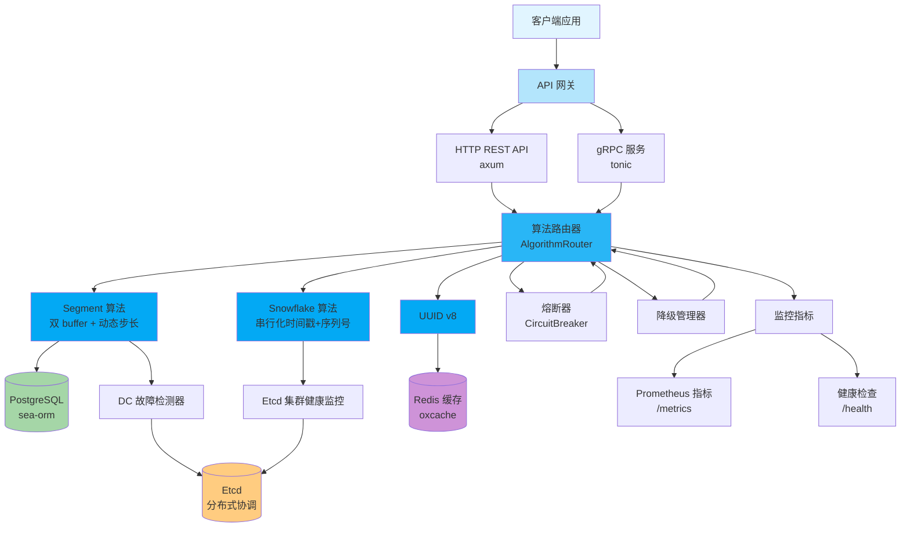
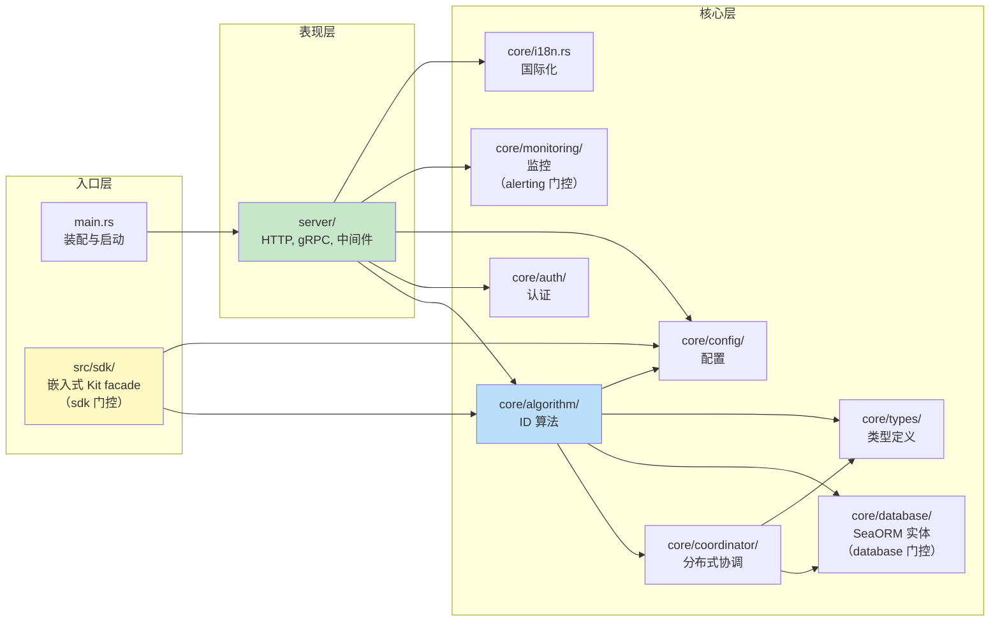
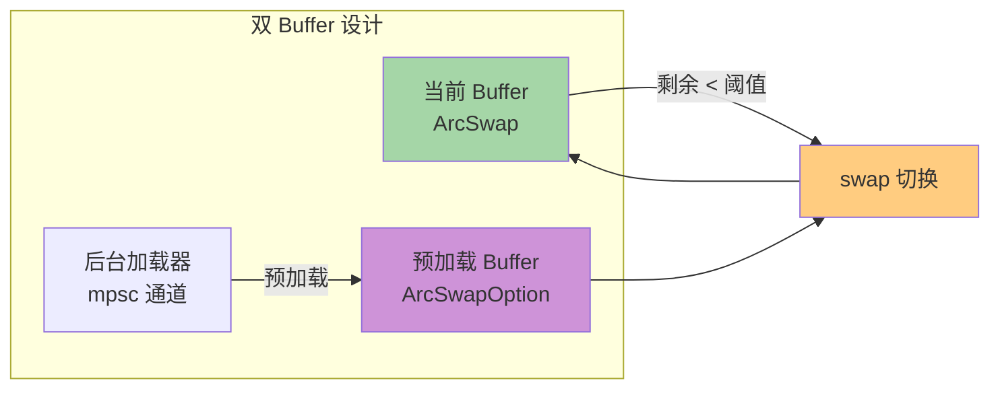
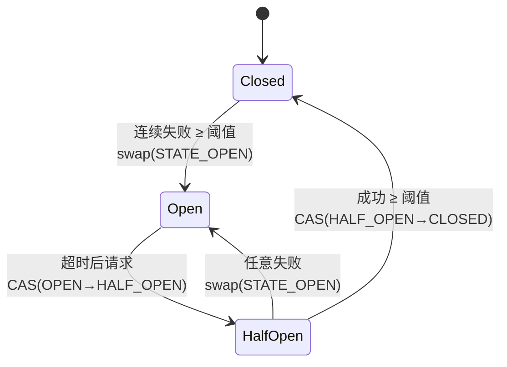

# 🏗️ Nebula ID Architecture

> This document describes Nebula ID's overall architecture, module dependencies, external library roles, and algorithm optimization design.

## 📋 Table of Contents

- [1. Overall Architecture](#1-overall-architecture)
- [2. Module Dependencies](#2-module-dependencies)
- [3. External Library Roles](#3-external-library-roles)
- [4. Algorithm Optimization Design](#4-algorithm-optimization-design)
- [5. mod.rs Interface Isolation Standard (Rule 25)](#5-modrs-interface-isolation-standard-rule-25)
- [6. Copyright Header Standard](#6-copyright-header-standard)
- [7. Cross-Platform Support (Rule 31)](#7-cross-platform-support-rule-31)
- [8. i18n Module Location](#8-i18n-module-location)
- [9. EtcdClientOps Trait Relationship Diagram](#9-etcdclientops-trait-relationship-diagram)
- [10. ConfigManagementService Trait Relationship Diagram](#10-configmanagementservice-trait-relationship-diagram)
- [Related Documents](#related-documents)

---

## 1. Overall Architecture



## 2. Module Dependencies



## 3. External Library Roles

The project decouples its infrastructure through 8 self-developed ecosystem crates.io libraries (one RC wave) plus 1 third-party library (versions are the current req lower bounds in `Cargo.toml`):

| Library | Version | Role | Usage |
|---------|---------|------|-------|
| `confers` | 0.6.0-rc.10 | Configuration management | Provides the `ConfigProvider` trait, environment variable expansion, and watch |
| `oxcache` | 0.5.0-rc.8 | Multi-level cache | Provides the `Cache` abstraction (memory + Redis) |
| `dbnexus` | 0.6.0-rc.9 | Database abstraction | Provides the PostgreSQL connection pool and transaction management |
| `sdforge` | 0.5.0-rc.8 | Service framework | Provides HTTP / gRPC / Web (OpenAPI) assembly macros; not service discovery |
| `inklog` | 0.3.0-rc.9 | Logging | Structured logging and fast-masking redaction |
| `garrison` | 0.9.0-rc.3 | Auth framework | API key verification (`garrison-auth` gated) |
| `trait-kit` | 0.5.0-rc.9 | Kit interface hub | AsyncKit modular assembly (pulled in only under the `sdk` gate) |
| `limiteron` | 0.3.0-rc.7 | Rate limiting | Provides core rate-limit primitives (TokenBucket / ConcurrencyLimiter) |
| `etcd-client` | 0.20 | Third-party etcd client | Distributed coordination (`etcd` gated) |

**Dependency feature-hygiene principle (Rule 28):**
- All external libraries use `default-features = false`, declaring required features explicitly
- `dbnexus`: `features = ["runtime-tokio-rustls", "with-chrono", "with-uuid"]` (`postgres` is passed in on demand by this crate's `postgresql` feature)
- `sdforge`: `features = ["http", "grpc", "openapi"]`
- `limiteron`: zero explicit features (postgres / quota-control / ban-manager are unused anywhere in the repo)

## 4. Algorithm Optimization Design

### 4.1 Segment Algorithm — Double-Buffer Lock-Free Design



**Optimization points:**
- `ArcSwap` replaces `Mutex<Arc<T>>`: lock-free reads, CAS writes
- `check_recovery` iterates under a read lock + mutates via AtomicU8 internally: only atomic state changes, leaving the HashMap structure untouched
- `get_or_create_buffer` fast path (read lock) + slow path (write lock) reduces lock contention
- `need_switch` merges two lock acquisitions into one, reducing lock overhead

### 4.2 Snowflake Algorithm — Lock-Free Sequence Number

**Optimization points:**
- `AtomicU64` stores the sequence number; `fetch_add` implements lock-free increments
- `OnceLock` caches the epoch start, avoiding a `checked_add` on every call
- `rotation_count` uses `Ordering::Relaxed` (statistics only, no memory-ordering dependency)
- Sequence overflow detection: `seq & sequence_mask == 0` triggers waiting for the next millisecond

### 4.3 Circuit Breaker — Fully Lock-Free State Machine



**Optimization points:**
- `AtomicU8` encodes the state (Closed=0, Open=1, HalfOpen=2)
- `AtomicU64` stores Instant nanosecond timestamps (relative to a global start), avoiding `Mutex<Option<Instant>>`
- State transitions use CAS (`compare_exchange`) to prevent concurrent transitions
- `transition_to_open` uses `swap` so the state takes effect immediately

## 5. mod.rs Interface Isolation Standard (Rule 25)

`mod.rs` may only contain:
- `trait` definitions
- `pub` structs/enums
- `pub` type aliases
- `pub use` re-exports

Concrete implementation functions must be split into separate files. Examples:
- `src/core/types/mod.rs` — re-exports only; `SegmentInfo` is split into `segment_info.rs`
- `src/server/middleware/mod.rs` — `api_key_auth` is split into `api_key_auth.rs` (489 lines)

## 6. Copyright Header Standard

All hand-written `.rs` files must carry the following copyright header:

```rust
// Copyright (c) 2025-2026 Kirky.X🌠
// SPDX-License-Identifier: Apache-2.0
```

**Exception:** auto-generated protobuf files (`src/server/proto/`) do not need the copyright header.

## 7. Cross-Platform Support (Rule 31)

- CPU monitoring: `#[cfg(target_os = "linux")]` reads `/proc/stat`; other platforms return default values
- No hardcoded path separators
- Cross-platform libraries (`tokio`, `parking_lot`, `arc-swap`)

## 8. i18n Module Location

Since v0.2.0, the ICU internationalization layer sits in the system architecture as follows:

```mermaid
graph LR
    Client[客户端请求<br/>Accept-Language 头] --> Gateway[API 网关<br/>axum Router]
    Gateway --> LocaleMW[locale_middleware<br/>src/server/middleware/locale.rs]
    LocaleMW -->|Extension&lt;Locale&gt;| V1Routes[/api/v1/* 路由]
    V1Routes --> Handlers[业务 Handlers<br/>src/server/handlers/*.rs]
    Handlers -->|错误转换| Helpers[helpers.rs<br/>core_error_to_response]
    Helpers --> I18n[i18n 模块<br/>src/core/i18n.rs]
    I18n -->|translate_with_locale_args| Locales[(locales/en/messages.ftl<br/>locales/zh/messages.ftl)]
    Locales -->|include_str! + 键集注册快照| I18n

    style LocaleMW fill:#ffcc80
    style I18n fill:#ce93d8
    style Locales fill:#a5d6a7
```

**Key design decisions:**

- **No global locale mutation**: the `translate_with_locale*` functions read the `Locale` parameter directly and query statically embedded compile-time data; they never call `set_locale`, so they are safe under concurrent requests (the lookup path has no `Mutex`; the SDK-side lock exists only in the process-level `get_locale`).
- **Middleware boundary**: `locale_middleware` applies only to `/api/v1/*` routes (a performance fix), sparing requests that never consume `Locale` — `/health`, `/ready`, `/metrics`, `/api-docs/openapi.json`, and friends — from paying the `Accept-Language` parsing cost.
- **Fallback chain**: a missing key first falls back to the default locale (`en`), then to the key itself (never an empty string), so error responses always carry a readable message.
- **Hidden API usage**: `translate_with_locale_cow` performs per-locale translation via the compile-time `include_str!`-embedded `locales/{en,zh}/messages.ftl` plus the key-set snapshot resolved at registration time (the flat FTL `key = value` forms are expanded at registration for `{ "\\u000A" }` string-literal placeholders). The internationalization baseline is unify-rust-i18n.
- **Dependency feature hygiene (Rule 28)**: the i18n key set is registered via `sdforge`'s `i18n::register_translation` (non-optional dependency, zero features); `fluent-bundle` / `unic-langid` have been removed along with it; this project ships a stricter `Accept-Language` parser (RFC 7231 §5.3.5 + DoS protection) in `locale.rs` and does not use the third-party `accept-language` crate.

## 9. EtcdClientOps Trait Relationship Diagram

The `EtcdClientOps` trait decouples etcd business logic from `etcd_client::Client`, letting the distributed coordinator receive mock injections in unit tests. The relationships:

```mermaid
graph TB
    subgraph Trait层
        Trait[EtcdClientOps trait<br/>src/core/coordinator/etcd.rs<br/>7 方法: kv_get/kv_delete/<br/>lease_grant/lease_revoke/<br/>txn_check_create_rev_and_put/ping/<br/>lease_keep_alive_once]
        Err[EtcdError enum<br/>Network/KeyNotFound/<br/>LeaseInvalid/Internal]
    end

    subgraph 实现层
        Wrapper[EtcdClientWrapper<br/>tokio::sync::Mutex&lt;etcd_client::Client&gt;<br/>impl EtcdClientOps]
        Mock[MockEtcdClientOps<br/>#[cfg(test)] mockall::mock!]
    end

    subgraph 调用方
        Lock[EtcdDistributedLock<br/>client: Arc&lt;dyn EtcdClientOps&gt;]
        Allocator[EtcdWorkerAllocator<br/>client: Arc&lt;dyn EtcdClientOps&gt;]
        Monitor[EtcdClusterHealthMonitor<br/>client: Option&lt;Arc&lt;dyn EtcdClientOps&gt;&gt;]
    end

    Wrapper -.->|impl| Trait
    Mock -.->|impl test only| Trait
    Trait -->|Arc&lt;dyn EtcdClientOps&gt; 注入| Lock
    Trait -->|Arc&lt;dyn EtcdClientOps&gt; 注入| Allocator
    Trait -->|Option&lt;Arc&lt;dyn EtcdClientOps&gt;&gt; 注入| Monitor
    Trait -->|返回值| Err

    style Trait fill:#bbdefb
    style Err fill:#ffcdd2
    style Wrapper fill:#a5d6a7
    style Mock fill:#fff9c4
    style Lock fill:#ffcc80
    style Allocator fill:#ffcc80
    style Monitor fill:#ffcc80
```

**Injection paths:**

- **Production path**: `EtcdClusterHealthMonitor::new` constructs with `client = None` and creates a fresh `etcd_client::Client` on every health check (behavior identical to v0.1.x, no breaking change).
- **Test path**: inject a mock via `new_with_client(Arc::new(MockEtcdClientOps))`; unit tests can verify business logic without connecting to a real etcd.
- **Interface isolation (Rule 25)**: `EtcdClientOps` and `EtcdError` are re-exported from `src/core/coordinator/mod.rs`; callers reference `crate::core::coordinator::EtcdClientOps` while implementation details stay hidden in the `etcd.rs` submodule.
- **`kv_put` deliberately omitted**: an architecture review found no business caller for `kv_put` (all writes go through the atomic `txn_check_create_rev_and_put` CAS), so it was removed from the trait per Rule 2 (simplicity first).

## 10. ConfigManagementService Trait Relationship Diagram

The `ConfigManagementService` trait decouples the HTTP handlers from the concrete `ConfigManager` implementation, letting handlers be fully tested against mocks. The relationships:

```mermaid
graph TB
    subgraph Trait层
        Trait[ConfigManagementService trait<br/>src/server/config/management.rs<br/>22 方法: get_config/get_secure_config/<br/>get_batch_max_size/update_rate_limit/<br/>update_logging/reload_config/<br/>set_algorithm/biz_tag CRUD/<br/>workspace&amp;group CRUD/metrics]
    end

    subgraph 实现层
        Manager[ConfigManager<br/>生产实现<br/>impl ConfigManagementService]
        MockCfg[MockConfigManagementService<br/>#[cfg(test)] mockall::mock!]
    end

    subgraph 调用方
        Handlers[ApiHandlers<br/>config_service: Arc&lt;dyn ConfigManagementService&gt;<br/>src/server/handlers/mod.rs]
        Router[create_router<br/>NebulaIdState.config_service:<br/>Arc&lt;dyn ConfigManagementService&gt;]
        Main[src/main.rs<br/>Arc::new(ConfigManager::new(...))<br/>coerce to Arc&lt;dyn ConfigManagementService&gt;]
    end

    Manager -.->|impl| Trait
    MockCfg -.->|impl test only| Trait
    Main -->|构造并 coerce| Trait
    Trait -->|Arc&lt;dyn ...&gt; 注入| Handlers
    Handlers -->|get_config_service| Router

    style Trait fill:#bbdefb
    style Manager fill:#a5d6a7
    style MockCfg fill:#fff9c4
    style Handlers fill:#ffcc80
    style Router fill:#ffcc80
    style Main fill:#c8e6c9
```

**Refactoring highlights:**

- **Name yield**: the former `ConfigManagementService` struct was renamed to `ConfigManager`, letting the trait own the canonical name. All callers use `Arc<dyn ConfigManagementService>` to reference the trait; implementation details are hidden behind `ConfigManager`.
- **Coercion at construction**: in `src/main.rs`, `Arc::new(ConfigManager::new(...))` auto-coerces to `Arc<dyn ConfigManagementService>` with no explicit cast.
- **Test coverage**: the `#[cfg(test)] mod tests` in `src/server/handlers/mod.rs` defines `MockConfigManagementService` with `mockall::mock!`, covering all ~18 trait methods. 55 new tests push the handlers module coverage to ≥ 95%.
- **Interface isolation (Rule 25)**: the `ConfigManagementService` trait is defined in `src/server/config/management.rs` with `mod.rs` re-exporting only; `ApiHandlers` holds the reference as an `Arc<dyn ConfigManagementService>` field, and every call inside the handlers goes through trait method dispatch.

## Related Documents

- [API Reference](API_REFERENCE.md)
- [Deployment Guide](DEPLOYMENT.md)
- [Contributing Guide](CONTRIBUTING.md)
- [User Guide](USER_GUIDE.md)
