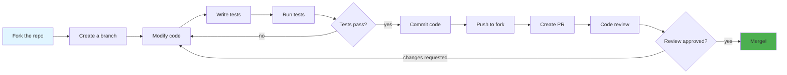

# 🤝 Nebula ID Contributing Guide

> Join us in building an excellent distributed ID generation system! Issues, discussions, and PRs are all welcome.

[🏠 Home](../../README.md) • [📖 User Guide](USER_GUIDE.md) • [💬 Discussions](https://github.com/Kirky-X/NebulaId/discussions)

---

## 🎯 Welcome, Contributors!

Thank you for your interest in **Nebula ID**! We look forward to your participation. Whether you fix bugs, add features, improve documentation, or help others, your contribution is invaluable.

<div align="center">

### 🌟 Ways to Contribute

<table>
<tr>
<td width="25%" align="center">
<br>
<b>Code</b><br>
Fix bugs & add features
</td>
<td width="25%" align="center">
<br>
<b>Documentation</b><br>
Improve docs & guides
</td>
<td width="25%" align="center">
<br>
<b>Testing</b><br>
Write tests & find bugs
</td>
<td width="25%" align="center">
<br>
<b>Community</b><br>
Offer help & support
</td>
</tr>
</table>

</div>

---

## 📋 Table of Contents

- [Code of Conduct](#code-of-conduct)
- [Getting Started](#getting-started)
- [Development Workflow](#development-workflow)
- [Coding Standards](#coding-standards)
- [Testing Guide](#testing-guide)
- [Documentation Standards](#documentation-standards)
- [Submitting Changes](#submitting-changes)
- [Review Process](#review-process)
- [Community](#community)

---

## Code of Conduct

<div align="center">

### 🤗 Kindness and Respect

</div>

We are committed to providing an inclusive and welcoming environment. By participating in this project you agree to:

<table>
<tr>
<td width="50%">

**✅ Encouraged behavior**
- Stay respectful and considerate
- Welcome newcomers
- Accept constructive criticism
- Focus on what is best for the community
- Show empathy toward others

</td>
<td width="50%">

**❌ Unacceptable behavior**
- Using offensive language
- Harassing or insulting others
- Publishing private information
- Personal attacks
- Disrupting discussions

</td>
</tr>
</table>

> 📜 **Code of conduct:** the table above is the summary of this repository's code of conduct; the repository does not yet ship a standalone `CODE_OF_CONDUCT.md` file.

---

## Getting Started

### Prerequisites

Before starting, make sure you have installed:

- ✅ **Git** - version control
- ✅ **Rust 1.75+** - programming language
- ✅ **Cargo** - Rust package manager
- ✅ **IDE** - VS Code, IntelliJ, or similar

<details>
<summary><b>🔧 Environment setup steps</b></summary>

**1. Install Rust:**
```bash
curl --proto '=https' --tlsv1.2 -sSf https://sh.rustup.rs | sh
```

**2. Install helper tools:**
```bash
# Code formatter
rustup component add rustfmt

# Static analysis
rustup component add clippy

# Coverage tool (optional)
cargo install cargo-tarpaulin
```

**3. Verify the installation:**
```bash
rustc --version
cargo --version
```

</details>

### Fork and Clone

<table>
<tr>
<td width="50%">

**1. Fork the repository**

Click the "Fork" button on GitHub

</td>
<td width="50%">

**2. Clone your fork**

```bash
git clone https://github.com/YOUR_USERNAME/NebulaId
cd NebulaId
```

</td>
</tr>
<tr>
<td width="50%">

**3. Add the upstream remote**

```bash
git remote add upstream \
  https://github.com/Kirky-X/NebulaId
```

</td>
<td width="50%">

**4. Verify the remotes**

```bash
git remote -v
# origin    your-fork
# upstream  Kirky-X/NebulaId
```

</td>
</tr>
</table>

### Build and Test

```bash
# Build the project (default = server + segment + snowflake + uuid-v8 + uuid-v7 + uuid-v5 + uuid-v4 + postgresql + garrison-auth; http/grpc are implied by server)
cargo build --package nebulaid

# All-features build (--all-features is buildable, covering etcd + sdk + alerting +
# integration-tests + openapi; CI and hooks uniformly adopt this switch)
cargo build --package nebulaid --all-features

# Run all tests
cargo test --package nebulaid --all-features

# Build docs
cargo doc --no-deps --package nebulaid
```

---

## Development Workflow

<div align="center">

### 🔄 Standard Contribution Flow

</div>



### Detailed Steps

#### 1️⃣ Create a branch

Branches should be created from `main` (the repository's only long-lived branch).

```bash
# Sync the upstream main branch
git fetch upstream
git checkout main
git merge upstream/main

# Create a feature branch
git checkout -b feature/ALGORITHM-id-generation

# Or a bugfix branch
git checkout -b bugfix/DC-health-monitor

# Or a docs branch
git checkout -b docs/update-readme
```

**Branch naming conventions:**
- `feature/*` - new feature development (e.g. `feature/segment-algorithm`, `feature/uuid-v7`)
- `bugfix/*` - defect fixes
- `hotfix/*` - urgent fixes
- `release/*` - version releases
- `refactor/*` - code refactoring
- `docs/*` - documentation updates
- `perf/*` - performance optimization

#### 2️⃣ Modify code

Follow the project's coding standards and best practices. See the implementation patterns in [src/core/algorithm/](../../src/core/algorithm/).

#### 3️⃣ Run static checks and tests

Before committing, make sure the code passes all local checks.

```bash
# Install git hooks (pick one)
lefthook install              # recommended: use lefthook
./scripts/run.sh install-hooks  # or use pre-commit

# Run the pre-commit check script (recommended)
./scripts/run.sh pre-commit

# Or run these steps manually:

# Format code
cargo fmt --all

# Run Clippy static analysis (must be warning-free)
cargo clippy --package nebulaid --all-features -- -D warnings

# Run all tests
cargo test --package nebulaid --all-features

# Run tests for a specific module
cargo test --package nebulaid --all-features --lib algorithm::segment
cargo test --package nebulaid --all-features --lib algorithm::snowflake
```

The **pre-commit check script** automatically runs:
1. Code formatting (cargo fmt)
2. Clippy static analysis
3. Build verification
4. Test execution
5. Security audit (cargo deny)

The **CI pipelines** (`.github/workflows/`) run automatically on PRs:
- `ci.yml`: lint → build → test → security audit
- `codeql.yml`: GitHub CodeQL semantic security analysis
- `code-review.yml`: AI code review

#### 4️⃣ Commit code

We follow the [Conventional Commits](https://www.conventionalcommits.org/) specification.

**Commit format:**
`<type>(<scope>): <subject>`

**Common types:**
- `feat`: new feature (e.g. `feat(algorithm): add UUID v7 implementation`)
- `fix`: bug fix (e.g. `fix(segment): resolve buffer overflow issue`)
- `docs`: documentation changes
- `style`: code formatting (no functional impact)
- `refactor`: code refactoring
- `perf`: performance optimization
- `test`: test-related
- `chore`: build tooling, dependency updates, etc.
- `ci`: CI/CD changes

**Nebula ID-specific scopes:**
- `algorithm` - ID generation algorithms (segment, snowflake, uuid)
- `coordinator` - distributed coordination module
- `health` - health monitoring module
- `server` - HTTP/gRPC service
- `config` - configuration management
- `database` - database integration

**Examples:**
```bash
git commit -m "feat(algorithm): add batch generation support for Segment"
git commit -m "fix(coordinator): resolve DC failover race condition"
git commit -m "docs: update USER_GUIDE with new examples"
```

#### 5️⃣ Push to your fork

```bash
git push origin feature/ALGORITHM-id-generation
```

#### 6️⃣ Create a Pull Request (PR)

1. Go to your fork on GitHub
2. Click "Compare & pull request"
3. Fill in the information per the [PR template](#submitting-changes)
4. Link the relevant issues
5. Submit the PR!

---

## Coding Standards

### Rust Best Practices

#### Ownership and borrowing
- Prefer borrowing over transferring ownership
- Use `&` for immutable borrows and `&mut` for mutable borrows
- Avoid unnecessary `.clone()`; prefer references
- Keep lifetime annotations as simple as possible

#### Type system
- Use the type system to express business constraints (NewType pattern)
- Prefer `Option<T>` over null values
- Use `Result<T, E>` for error handling; `panic!` is strictly forbidden in library code
- Implement the `std::error::Error` trait for custom errors

#### Concurrency and async
- Use `Arc<T>` to share immutable data and `Arc<Mutex<T>>` or `Arc<RwLock<T>>` for mutable data
- Prefer channels for inter-thread communication
- Use `async/await` in async code; never block the runtime

#### Performance
- Use `Vec::with_capacity()` to preallocate memory
- Prefer iterator chains over explicit loops
- Prefer `&str` over `String` for function parameters
- Avoid unnecessary heap allocations

### Naming Conventions
- Modules, functions, variables: `snake_case`
- Types, traits: `PascalCase`
- Constants, statics: `SCREAMING_SNAKE_CASE`

### Code Quality Requirements
- **Zero-warning state**: never ignore compiler warnings. All warnings must be fixed before committing.
- **Clippy**: must pass `cargo clippy` without introducing new lint warnings.
- **Documentation**: all public APIs must have doc comments.

---

## Testing Guide

### Testing Principles
- **TDD**: the "red-green-refactor" cycle is encouraged.
- **Never disable tests**: when a test fails, fix the code or the test — never disable it.
- **Authenticity**: unless external hardware or uncontrollable services are involved, never use mocks/stubs; prefer real implementations.

### Test Pyramid
1. **Unit tests**: fast, isolated, verifying core logic. Located under `src/`, annotated with `#[cfg(test)]`.
2. **Integration tests**: verify interactions between modules. Located in the `tests/` directory.
3. **E2E tests**: verify critical business flows.

### Coverage Requirements
- **New code coverage**: ≥ 90% (same methodology as the local pre-push coverage gate).
- **Core business logic**: 100% coverage.

```bash
# Generate a coverage report (CI and the pre-push gate both use cargo-llvm-cov;
# the optional coverage step of scripts/run.sh pre-commit uses cargo-tarpaulin)
cargo llvm-cov --package nebulaid --fail-under-lines 90

# The authoritative CI gate (default leg, excluding server/proto/ generated code, ≥ 95%)
cargo llvm-cov --package nebulaid \
  --fail-under-lines 95 --ignore-filename-regex "server/proto/"
```

---

## Documentation Standards

- **Public APIs**: every `pub` item must carry a `///` doc comment.
- **Example code**: doc comments should include runnable examples.
- **Update sync**: code changes must be synced into the related README and API documentation.
- **Algorithm docs**: new algorithm implementations need design documentation added in `docs/en/ARCHITECTURE.md`.

---

## Submitting Changes

### PR Submission Standards
- **Atomicity**: each commit/PR should contain a single logical change.
- **Size limit**: keep PR diffs within ~400 lines where possible.
- **Linked issues**: the PR description must link the relevant issues.

### PR Template

```markdown
## Change type
- [ ] New feature (feat)
- [ ] Bug fix (fix)
- [ ] Refactor (refactor)
- [ ] Documentation (docs)
- [ ] Performance (perf)
- [ ] Tests (test)
- [ ] Other

## Description
Briefly describe the purpose and content of this change.

## Testing
- [ ] Unit tests pass
- [ ] Integration tests pass
- [ ] Manual testing done
- [ ] Performance tests pass (if applicable)

## Checklist
- [ ] Code follows the project coding standards
- [ ] Necessary tests added
- [ ] Documentation updated
- [ ] No new warnings introduced (Zero Warning)
- [ ] Changes pass cargo clippy
- [ ] Changes pass cargo fmt
- [ ] Changes pass ./scripts/run.sh pre-commit (formatting, static analysis, build, tests, security audit, docs, coverage)

## Related issues
Closes #123

## Additional information
(screenshots, logs, or other supplementary material if necessary)
```

---

## Review Process

### Review Focus
- **Functionality**: meets requirements, logic correct, ID generation algorithms conform to spec.
- **Code quality**: follows SOLID principles, readable, no duplicated code.
- **Security**: no hardcoded secrets, input validated, concurrency safety considered.
- **Performance**: no obvious performance hazards; watch atomic operations and lock usage.
- **Testing**: test coverage and quality meet requirements.

### Responding to Review Feedback
- Reply to reviewer comments promptly.
- Push changes in response to feedback; the PR updates automatically.

---

## Community

- **GitHub Discussions**: ask questions, share ideas, discuss design decisions.
- **Issue Tracker**: report bugs and file feature requests.
- **Algorithm discussions**: for design discussions of new ID algorithms, elaborate in the PR.

Thank you for contributing to **Nebula ID**! 🚀

---

<div align="center">

**[📖 Documentation](USER_GUIDE.md)** • **[🐛 Report an issue](https://github.com/Kirky-X/NebulaId/issues)** • **[💬 Discussions](https://github.com/Kirky-X/NebulaId/discussions)**

Made with ❤️ by Kirky.X

</div>
